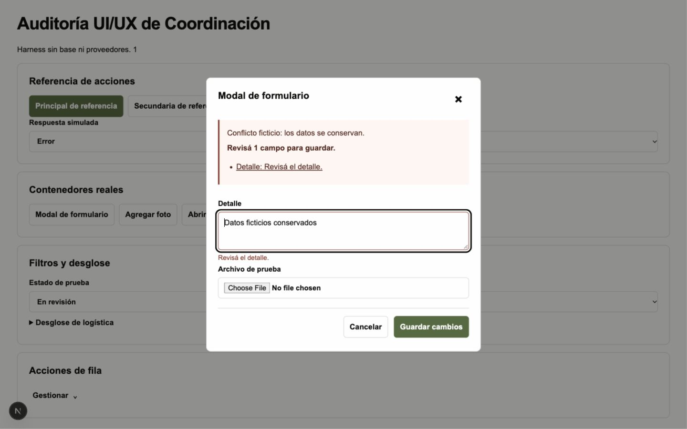
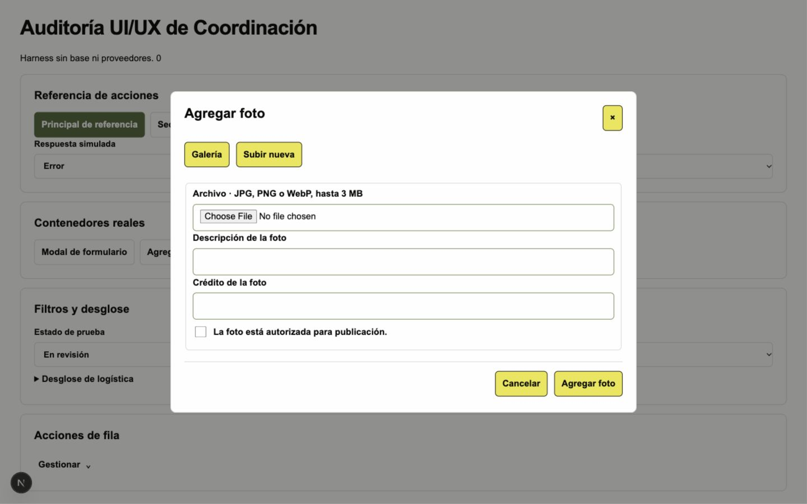

# Auditoría de consistencia UI/UX de Coordinación

16 de noviembre de 2026. Base publicada `3e0a187332414203201a53092acada85723abee3`. Análisis y documentación: **sin modificaciones de aplicación o estilos**. No hubo beta, base de datos, Graph, correo, cargas reales ni publicación.

Seguimiento posterior: [UX01/UX02 implementadas y verificadas localmente](actualizacion-modal-fotos.md). La [revisión posterior de otros paneles](revision-modales-paneles.md) documenta UX04 y descarte. La [evaluación posterior de UX03](contraste-controles-coordinacion.md) corrige límites de entradas en alcance local verificado. Las observaciones siguientes conservan el estado anterior a las correcciones.

## Resultado principal

**Se reprodujeron los botones amarillos en PhotoDialog en desktop y celular.** No falta la clase principal: el submit ya tiene coord-button-primary. El diálogo se renderiza con createPortal en document.body, fuera de .coordination-content; pierde tanto sus tokens como los selectores descendientes de Coordinación. Entonces actúa la regla global de botones. Esto afecta acción principal, Cancelar, Cerrar, pestañas, descarte y apariencia de disabled. No es evidencia de que todos los modales sean antiguos.

No se encontraron botones amarillos en las variantes ejercitadas de ActionModal, TableFilters, MobileDisclosure o RowActionPanel. No se extiende esa conclusión a todas las pantallas de negocio no abiertas.

## Método, marca y patrón de referencia

Se revisaron AGENTS, README, TODO, guías de implementación/componentes, auditoría de utilidades, errores y contratos de formularios, código y git log/blame. La guía instalada de Next sobre fronteras servidor/cliente también se consultó. El árbol inicial no tenía cambios de aplicación; `.codex/` sin seguimiento se dejó intacto.

Fuente de marca local: [Lineamientos de Marca Prueba 1.pdf](</Users/alvaroalpizar/Documents/ASVO/Lineamientos de Marca Prueba 1.pdf>), siete páginas; extracción de texto y revisión visual renderizada de páginas 1 y 2. La página 1 establece #658048, #ebe544, #6f716d, #fefefe y #080907; página 2 muestra alternativos. Es una guía de marca/redes, **no especifica un sistema de botones, diálogos o estados**. No se interpreta como orden de sustituir todos los verdes por el color literal de marca.

La aplicación conserva esa paleta en app/style.css:1–12. Coordinación utiliza un verde más oscuro #526a3d y hover #40552e, secundarias blancas, destructivas suaves #fbefec con texto #852f24, radio .625rem y objetivos habituales de 44px. Se adopta como referencia por jerarquía, accesibilidad y consistencia entre componentes activos, no solo por ser reciente.

| Rol | Referencia observada | Excepciones justificadas |
| --- | --- | --- |
| Acción principal | Verde #526a3d / texto #fefefe; hover #40552e | El portal público usa amarillo: queda fuera de una sustitución global |
| Secundaria / Cancelar | Blanco, texto oscuro y borde gris | Volver de un menú es una acción de texto/transparente |
| Destructiva | Fondo suave rojo y texto oscuro rojo | No usar el color como única explicación: conservar verbo/motivo |
| Cerrar | X con nombre accesible; 44px en el alcance de Coordinación | Menú compacto de desktop sin X es deliberado; móvil sí muestra X |
| Error / advertencia | Resumen y mensajes junto al campo; advertencias suaves | Amarillo en advertencias, pills revisión/espera, skip link o banner de edición no implica estilo viejo |
| Éxito | Franja temporal, no alerta persistente dentro del modal | Preparar una foto local no es confirmar persistencia |

La tipografía base es Arial/Helvetica; el alcance de Coordinación usa peso 600 en botones y el fallback global 700. No se encontró motivo para otra familia tipográfica. Los diálogos de 36rem y la variante ancha de fotos de 52rem son tamaños deliberados; el problema no es ese ancho. Bordes/radios y densidad deben compararse por función, conservando menús compactos y formularios anchos.

Comparación capturada, sin maquetas ni cambios de estilo:

| Referencia actual: ActionModal | Variante inconsistente: PhotoDialog |
| --- | --- |
|  |  |

## Inventario y cobertura

[Inventario AST](evidencia-uiux/inventario.json): 125 archivos JS/TS de app revisados; usos JSX de imports nombrados, con wrappers y guardas contrastados manualmente. Son sitios de composición, **no un censo de pantallas abiertas ni demostración de alcanzabilidad de cada rama**. No se recomienda eliminar interfaces por esos conteos.

| Componente | Usos / módulos | Consumidores y alcance | Verificación nueva |
| --- | --- | --- | --- |
| ActionModal | 5 / 5 | Corregir ficha, unidades, RegistryModal, recordatorios y separar agrupación | Componente real con acción ficticia; inicial/error/pending/descarte desktop y error/éxito móvil. No cada consumidor con permisos reales |
| CoordinationModal | 10 / 7 | ActionModal, agregar/editar inscripción, PhotoDialog, secciones y descartes de editores | Contenedor real y formulario ficticio largo de 16 controles en ambos viewports |
| PhotoDialog | 5 / 3 | Adjuntar fotos del detalle, editor individual/bloque, nueva salida | Alta persistente con callback simulado, archivo ficticio, error/pendiente/descarte desktop y alta/error/pestañas móvil. Prepare, edición y galería poblada: código, no nueva CUA |
| RegistryModal | 2 / 2 | Conciliación de asistencia y póliza en ficha | Código y composición por ActionModal; no recorrido visual nuevo propio |
| RowActionPanel | 2 / 2 | RegistrationActions y tabla de series | Contenedor real con acciones/contenido ficticios: menú desktop, panel móvil y paso ampliado. No ejecuta decisiones reales |
| TableFilters | 7 / 7 | Resumen, convocatorias, series, solicitudes, voluntariado, inscripciones de salida y selector de serie | Contenedor real: inline desktop, modal móvil, cerrar/Ver resultados. Criterios ficticios |
| MobileDisclosure | 3 / 3 | Transporte, alimentación y resumen de salida de Coordinación | Componente real: details desktop y desglose móvil con contenido ficticio |
| PrivateLinkForm | 2 / 2 | Invitación y enlace del 70 | Código; no nueva CUA de esos formularios |
| ReportReminder | 2 / 2 | Resumen y RegistrationActions | Código y composición por ActionModal; no envío/recordatorio real |
| Informes, ficha completa, importaciones, permisos, serie y formularios largos de negocio | Varias páginas | Reutilizan componentes inventariados o edición por secciones | Inspección estática aplicable; no se abrieron todas las rutas autenticadas ni sus estados |

Se conservan adaptadores, contratos publicados y ramas legadas. Su retiro sigue en R2 y requiere su propia evidencia. Los ejemplos públicos del 70 no se presentan como nuevos recorridos de Coordinación.

## Hallazgos y recomendaciones acotadas

P2 = priorizar corrección de consistencia/accesibilidad; P3 = mejora acotada o candidato que necesita reproducción adicional. En el momento de esta auditoría ninguna fila estaba implementada; consultar el seguimiento posterior para UX01/UX02.

| ID / estado | Pantalla, recorrido y estado | Causa / regla y alcance | Evidencia | Impacto y corrección mínima | Consumidores y aceptación posterior |
| --- | --- | --- | --- | --- | --- |
| UX01 **P2 confirmado** | Agregar foto, desktop 1440×900 y móvil 390×844; inicial, errores, descarte, selección y disabled | photo-dialog.tsx:34–fin monta en body. coordination.css:45–52 define tokens en .coordination-content; :25,35,75–86 dependen de ese ancestro. style.css:174–181 aplica amarillo/negro global | foto-desktop, foto-mobile, foto-descarte-desktop y medidas. closest('.coordination-content')=false; --coord-primary vacío; selector principal no coincide. Fondo #ebe544 aunque hay clase coord-button-primary | Principal/Cancelar/Cerrar y pestañas aparentan la misma prioridad; X mide 35,34×45,19 frente a 44px del patrón. Restaurar el alcance visual/tokens en el portal o hacer autosuficiente el contenedor existente, de forma acotada. Conservar portal para evitar formularios anidados; no moverlo ciegamente dentro de otro form ni eliminar el amarillo global | Los cinco usos PhotoDialog de tres módulos. Probar prepare/persist/edit, galería/subida, errores, descarte, hover/focus/disabled, móvil, archivos y ausencia de cambios al portal público |
| UX02 **P3 confirmado**, separado de UX01 | Foto en guardado demorado desktop | photo-dialog.tsx:37: photo-source-tabs fuera del fieldset disabled y sus botones sin disabled={pending}. Tiene guard busy para no duplicar guardado | photo-desktop-pending: submit/cancelar/cerrar disabled, Galería/Subir nueva habilitadas. Una invocación ficticia en doble clic | Permite cambiar de modo mientras se procesa una elección capturada. Revisar bloqueo coherente de esas dos acciones mientras pending, manteniendo busy/finally y datos. No se constató corrupción o duplicado | PhotoDialog. Simular demora, rechazos, éxito y reintento; verificar elección/archivo y controles recuperados |
| UX03 **P2 medición confirmada; evaluación normativa pendiente** | Campos neutrales del patrón actual, además de bordes secundarios | coordination.css:83 y token --line #d4d8d0 sobre #fefefe. Contraste calculado 1,43:1 | Medidas de inputs scoped + contraste.json. No es un defecto de amarillo ni del portal | Revisar controles cuya única delimitación es ese borde frente al criterio no textual 3:1. No declarar fallo WCAG de toda la plataforma ni de cada botón: depende de su representación. Si hace falta, ajustar el borde de controles, no oscurecer todos los separadores globales | Formularios y filtros compartidos. Comprobar estado vacío/no enfocado, boundary/label, hover y foco en pantallas reales antes de cerrar la revisión |
| UX04 **P3 candidato de interacción** | Gestionar → paso ampliado, desktop y móvil | RowActionPanel + reemplazo de hijos: el botón enfocado se desmonta. No hay traslado explícito al nuevo heading/control en ese cambio | row-desktop-expanded y row-mobile-expanded devolvieron BODY como foco, con hijos ficticios | Reproducir en RegistrationActions/colecciones reales antes de afirmar defecto de consumidor. Si persiste, enfocar heading o primer control al cambiar de paso; reutilizar panel y respetar errores | Inscripciones y series; teclado, Escape/Volver, retorno al disparador y errores deben probarse con consumidores completos |
| UX05 **P3 riesgo estático, no defecto global demostrado** | Botones que escapen al alcance visual de Coordinación | style.css:174 usa button:not([name]) como criterio de amarillo. La semántica HTML de name no equivale a jerarquía visual; ya explica UX01 | Código/blame y selector efectivo de PhotoDialog | Corregir primero UX01. Al tocar la familia, revisar dependencia de reglas globales, sin reemplazo masivo ni nuevo sistema de componentes | No se presume que todo botón sin name esté mal. Hacer barrido de portales y comparar páginas públicas si se cambia esa regla |

UX01 agrupa sus efectos de pestañas, X, descarte y opacity: no son cuatro tareas independientes con la misma causa. En el portal las acciones disabled tenían opacity 1; en ActionModal se aplica .5. Disabled funciona como atributo, pero su señal visual pierde uniformidad. El contraste de controles deshabilitados no se presenta como incumplimiento de texto normal.

Historia pertinente: el alcance de botones ya existe en la base 14eb78e; el portal de PhotoDialog figura en c65e5ba (11/11). La revisión de contratos en 4733691 no cambió esa ubicación. Esto explica la coexistencia, sin atribuir el problema a la refactorización de feedback más reciente.

## Medidas, estados y accesibilidad

[27 observaciones nuevas](evidencia-uiux/mediciones.json). Estilos computados del DOM, dimensiones de elementos, relación DOM del portal y coincidencia de selectores se contrastaron con los archivos fuente. No se usó CSSOM para atribuir cada declaración a una hoja emitida: las rutas/líneas del informe provienen del código y el selector efectivo se probó mediante matches. No hay medición universal de la cascada del sitio.

[Contraste](evidencia-uiux/contraste.json), fórmula WCAG de luminancia sRGB para pares opacos:

- Blanco/verde de Coordinación: **5,97:1**; hover oscuro: **8,14:1**.
- Negro/amarillo ASVO: **15,03:1**. El amarillo no es ilegible por sí mismo.
- Blanco/verde literal de marca #658048: **4,40:1**, por debajo de 4,5 para texto normal; sustituir automáticamente el verde oscuro sería contraproducente.
- Rojo oscuro/suave destructivo: **7,68:1**; gris #6f716d/blanco: **4,89:1**.

No es certificación WCAG de pantallas completas, opacidades, imágenes o todos los estados. Hover global negro/amarillo se observó al pulsar Galería y mantener el puntero allí; el verde oscuro del botón de ActionModal también aparece en las medidas móviles. :active solo se revisó en código, no se capturó durante presión sostenida. Focus-visible global tiene outline negro; no se recomienda retirar ese contorno para uniformar colores.

Los botones medidos tienen en general ≥44px de alto; menús desktop usan deliberadamente mínimo 36px y el panel móvil 44px. La X portaleada pierde los 44px de ancho del patrón, pero 35px no demuestra por sí solo incumplimiento del mínimo WCAG 2.2 AA de 24px. No se auditó zoom al 200/400 % ni teclado virtual de un teléfono físico.

### Comprobaciones que conservaron comportamiento

- ActionModal y PhotoDialog: pending real con callback demorado ficticio, doble clic y una invocación por intento. Error general/campo, recuperación de controles y datos conservados. No se implementaron pruebas nuevas de idempotencia.
- Foto: PNG ficticio de 8×8 seleccionado con file chooser; preview local, alt/crédito y valor del archivo conservaron su selección tras error. No se inspeccionaron bytes ni se subió a Graph. Error de crédito recibió foco en desktop; el primer error local desktop enfocó archivo.
- En las capturas inmediatas de error móvil aparece BUTTON como foco: no se esperó/reverificó el ciclo de revelado en esos casos. **No se certifica el foco final móvil ni se clasifica esa lectura transitoria como defecto**. Resumen y controles mantienen ARIA; faltan recorridos completos de cada consumidor.
- Escape/cierre, descarte y nombres de cierre disponibles fueron ejercitados. El límite de Tab del diálogo nativo puede ir a BODY/chrome en IAB; no se certifica una trampa personalizada ni un lector hablado. Se conserva ese límite junto con la evidencia anterior de formularios, sin llamarla una ejecución nueva.
- Formulario largo compartido: después de enfocar el campo 16, su borde inferior quedó antes del footer (desktop 764,59 < 784,59px; móvil 723,28 < 743,22px), sin quedar tapado. Header/footer sticky visibles; no hay overflow horizontal observado. Es un contenedor con 16 campos ficticios, no validación de todo editor real.
- TableFilters móvil: cierre/X y Ver resultados, look consistente; desktop inline es intencional. MobileDisclosure usa details en desktop y diálogo móvil. RowActionPanel: menú compacto de 304px desktop y panel de 390px al pie en móvil. Ausencia de X en menú desktop es una preferencia vigente, no una inconsistencia.
- Éxito ActionModal móvil: cierre y franja «Guardado ficticio confirmado.». La duración está en StatusRibbon; no se cronometró su ocultamiento en esta tarea. Una respuesta UI simulada no prueba commit ni entrega de correo.

## Plan mínimo y criterios de cierre

1. **Alcance visual del portal de fotos (UX01).** Restaurar tokens y variantes del sistema existente. Verificar primero PhotoDialog; luego sus cinco usos. No corregir cada botón aisladamente, no usar !important indiscriminado y no cambiar styles globales del portal público para ocultar la causa.
2. **Coherencia pending en PhotoDialog (UX02).** Una modificación acotada, separada de la paleta. Verificar tabs, busy, doble clic, recuperación, datos/archivo y descarte.
3. **Validación de bordes y pasos (UX03/UX04).** Primero reproducir en consumidores reales y evaluar el criterio normativo; solo después corregir. Si no se reproduce, documentarlo sin crear una nueva arquitectura.
4. **Completar la matriz por consumidores.** Corregir ficha/unidades/póliza/incidentes/conciliación, alta/edición/decisiones, informes/enlaces/recordatorios, series, galería poblada y edición. Conservar diferencias de layout justificadas y las pruebas existentes.

Cierre de cada corrección: capturas comparables, selectores/estilos efectivos, teclado/foco, errores y pendiente, viewport desktop/móvil, ausencia de regresión en el resto de Coordinación y páginas públicas afectadas. No dar por implementada una corrección por inventariarla.

Decisiones del usuario: priorizar UX01 y UX02; confirmar si se mantiene la jerarquía verde/blanco/rojo actual. No hay evidencia para imponer una identidad nueva ni para elegir otra familia tipográfica en esta tarea.

## Entorno, reproducibilidad y límites

CUA IAB, viewports explícitos 1440×900 y 390×844. Next webpack dev en copia desechable, Node 26.13.1, sin dotenv; preload de bloqueo externo existente. Componentes importados sin cambios desde la aplicación. [Página del harness](evidencia-uiux/page.jsx.txt) y [runner](evidencia-uiux/harness.mjs.txt) conservados como documentación **.txt**, nunca instalados como ruta del proyecto. Para reproducir se requieren rutas temporales equivalentes y el mismo guard; no son una nueva aplicación o suite de CI autónoma.

RowActionPanel contiene marcado/formulario ficticio: no se confunde con RegistrationActions completo. El formulario largo también es representativo del contenedor. No se probaron permisos reales, consultas de personas, informes completos, vínculos del 70, modales de importación con archivos reales, ni una galería poblada por SharePoint.

No se ejecutaron TypeScript, unitarias, SQL o build de producción nuevos: no hay cambios funcionales. Se validaron el inventario, JSON, enlaces locales del informe y diff; el servidor dev compiló los componentes ejercitados. Pruebas de etapas anteriores son evidencia histórica y no sustituyen la cobertura visual pendiente.

Limitaciones: una sola familia de navegador, sin dispositivos físicos, lector de pantalla hablado, teclado virtual o matriz exhaustiva de zoom/hover/active. CSS sin consumidor demostrado sigue como candidato; no se borra ninguna interfaz ni rama. No se asegura que no exista otro modal con el mismo problema fuera de lo inventariado.

Se retiraron servidor/copia del harness, PNG de prueba, renders PDF y runtime temporales. Permanecen solo informe, inventario y evidencia ficticia. Sin cambios de app, estilos, dependencias, permisos, proveedores o datos beta; sin publicación ni workflows.
